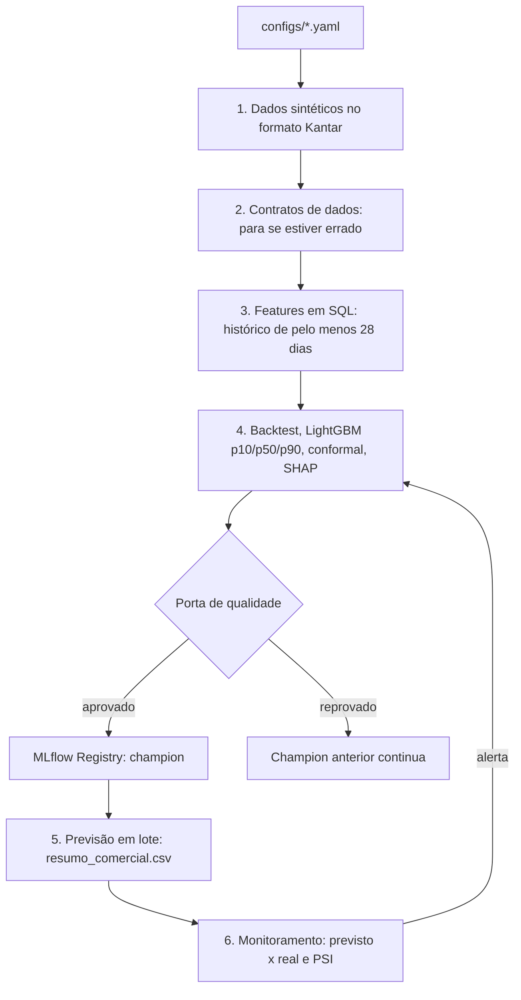

# O Oráculo 2.0: quanta audiência dá para prometer?

[](https://github.com/yasminroch/The-Oracle-Project/actions/workflows/ci.yml)

> **Todos os dados e resultados deste projeto são sintéticos.** Os dados reais de 2022 são confidenciais e não estão aqui.

## O problema de negócio

O comercial de uma emissora vende audiência semanas antes de ela acontecer. O anunciante compra pontos de rating no público dele, como mulheres ou jovens de 18 a 34 anos. Se a emissora promete mais do que entrega, compensa o anunciante com inserções grátis. Se promete menos, vendeu barato. Este projeto prevê a audiência de cada bloco de 15 minutos, para 10 públicos, **28 dias antes**, com uma faixa de previsão. A parte de baixo da faixa é a **entrega segura**: quanto dá para prometer com baixo risco de compensar.

## A história do projeto

Em 2022, no Inteli, um time de seis pessoas construiu O Oráculo com a Rede Gazeta: um modelo que previa a audiência por faixa horária, publicado em um site. Revisando o trabalho, encontrei problemas que mudam a leitura do resultado. O R² de 0,956 vinha de uma divisão aleatória, em que o modelo via o próprio dia no treino. E um bug na API sobrescrevia data, feriado e categoria com o valor da hora, de modo que o site dava a mesma previsão para qualquer dia naquele horário.

Esta versão começa pelo uso comercial e reconstrói o método. O código original está preservado em [`legado/`](legado/), e o diagnóstico completo em [`docs/aprendizado/fase_00.md`](docs/aprendizado/fase_00.md).

| 2022 | Agora | Por quê |
| --- | --- | --- |
| Divisão aleatória | Backtest temporal, 28 dias à frente | A venda acontece antes, e a data futura é inédita |
| Só calendário e categoria | Histórico de 4 a 52 semanas, concorrência, tendência, estreias | O histórico é o sinal mais forte |
| R² chamado de "precisão" | Erro em pontos, WAPE, viés, cobertura | É assim que o comercial decide |
| Um número | Faixa p10–p90 calibrada | O p10 é o que dá para prometer |
| Notebook e pickle no Drive | Pipeline testado, MLflow e porta de qualidade | Dá para refazer, comparar e auditar |
| API Flask | Tabela semanal para o comercial | Combina com a rotina de venda |
| Sem testes nem monitoramento | Contratos de dados, teste anti-vazamento, CI/CD, alertas | Erros aparecem antes de chegar à venda |

## Resultados (dados sintéticos, semente 42)

| Medida | Modelo | Baseline (média de 4 a 7 semanas atrás) |
| --- | --- | --- |
| Erro total (WAPE) no backtest, 4 cortes | **8,7%** | 9,9% |
| WAPE no horário nobre | 8,5% | 9,7% |
| Erro médio (MAE) | 0,42 ponto | 0,48 ponto |
| Viés (positivo = promete demais) | −0,01 ponto | +0,12 ponto |

**Quando o modelo vale a pena.** Em meses normais, o baseline quase empata: o modelo é só 2% a 6% melhor. A diferença aparece quando a grade muda. Em dezembro, com a pausa do futebol, o WAPE foi de 8,9% contra 12,9%, e o baseline prometeria 0,43 ponto a mais. Com grade estável, a média simples bastaria.

| Outras verificações | Resultado |
| --- | --- |
| Cobertura da faixa de 80% no último corte | 68,6% sem ajuste, **79,6%** com conformal |
| Divisão aleatória, como em 2022 | WAPE 7,8% e R² 0,977: mais otimista que o backtest (8,7%) |
| Monitor com choque simulado em janeiro | **ALERTA**: WAPE 17,4%, viés +0,61 ponto, cobertura 49% |
| Monitor sem o choque (controle) | OK: WAPE 9,3%, cobertura 83% |
| Efeito de campanha em R | Ingênuo +23,2%; diferença em diferenças **+11,5%** (IC 10,2% a 12,7%); placebo 0,0%; p = 0,001. O efeito simulado era +12% |

O que mais pesa nas previsões (SHAP): média das últimas 4 semanas úteis, nível do horário entre 28 e 56 dias atrás, e faixa do programa.

## Como o comercial usaria

Uma linha de `data/outputs/resumo_comercial.csv`:

| semana | faixa_programa | publico | rating_previsto | entrega_segura_p10 | cenario_otimista_p90 |
| --- | --- | --- | --- | --- | --- |
| 2025-01-06 | novela_21h | feminino | 16,52 | 14,15 | 18,29 |

Lida em voz alta: *"Na semana de 6 de janeiro, a novela das 21h deve entregar 16,5 pontos em mulheres. Dá para prometer 14 pontos com segurança, e o cenário otimista é 18."*

## Arquitetura



```text
legado/          código original de 2022, preservado
documentos/      documentação original de 2022
configs/         todos os parâmetros (config.yaml e smoke.yaml)
src/oraculo/     data, features, models, monitoring, pipeline
tests/           contratos, anti-vazamento, métricas, pipeline de fumaça
r/               incrementalidade em R base
pipelines/       exemplo de DAG no Airflow
docs/            specs, notas de aprendizado e model card
.github/         CI e CD
```

## Como rodar

Requer Python 3.11 e `make`. Docker e R são opcionais.

```bash
make setup             # cria o ambiente virtual e instala
make smoke             # pipeline inteiro em segundos
make pipeline          # pipeline completo, cerca de 2 minutos
make test && make lint
make mlflow-ui         # http://localhost:5000
make incrementalidade  # requer R
make docker-build && make docker-run
```

Copie `.env.example` para `.env` se quiser apontar para outro servidor MLflow. Saídas em `data/outputs/` e `data/relatorios/`. Detalhes do modelo em [`docs/model_card.md`](docs/model_card.md).

## Limitações

- Os dados são sintéticos: os números demonstram o método, não a acurácia em audiência real.
- Um mercado só. Share e fidelidade estão fora do escopo.
- Choques sem sinal nas variáveis não são previsíveis. O monitor detecta depois que o real chega.
- A faixa foi calibrada só nos cortes do backtest.
- Os eventos exclusivos das concorrentes existem nos dados, mas não viram variável.

## Próximos passos

- Migrar para Spark e Databricks: o SQL do DuckDB vira Spark SQL com poucas mudanças, e o MLflow já é o mesmo.
- Feature store para reaproveitar as variáveis.
- Previsão de share e de alcance de campanha.
- API, se algum uso precisar de resposta na hora.
- Painel de monitoramento.

## Aviso e créditos

Dados sintéticos, sem nenhum dado pessoal. Projeto original [Data-Oracles](https://github.com/2022M3T5-Inteli/Data-Oracles) © Inteli, Gábrio Lina, Gustavo Pereira, Patrícia Honorato, Tainara Rodrigues, Victor Carvalho e Yasmin Rocha, sob licença [CC BY 4.0](http://creativecommons.org/licenses/by/4.0/). A reconstrução é de Yasmin Rocha, feita com apoio de um assistente de IA.
